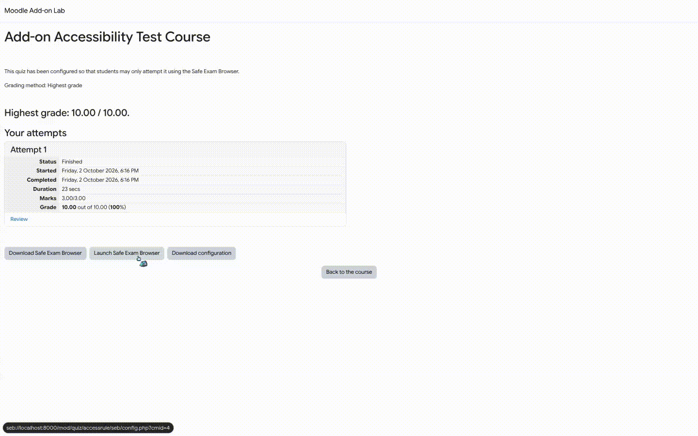
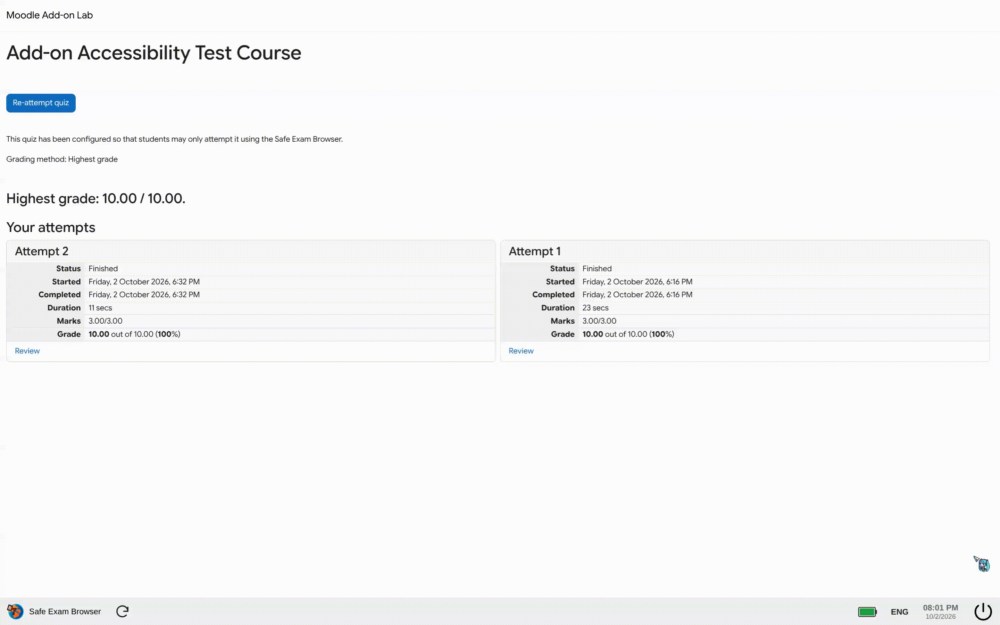
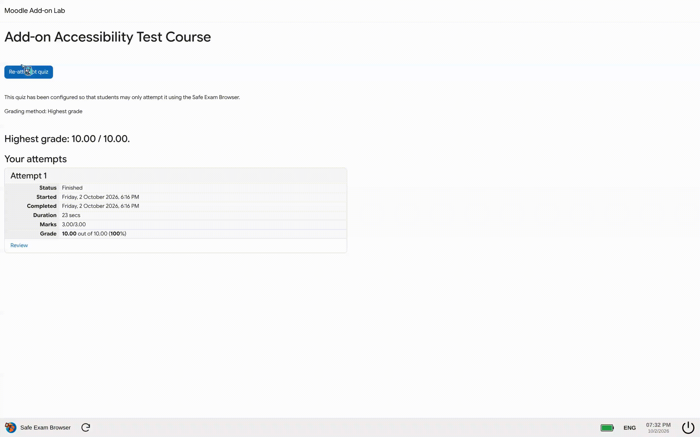

<p align="center"></p>

# OEB — Open Exam Browser

**2.4.0** · Open `.seb` files and SEB launch links in Firefox or compatible Chromium browsers, with optional AI-powered Moodle autofill.

Based on [UmmItKin/SebBypass](https://github.com/UmmItKin/SebBypass) and the archived [cycyrild/SebBypass](https://github.com/cycyrild/SebBypass).

## Features

- Detect extensionless exam files and replace the previously loaded configuration.
- Automatic BEK calculation for **SEB 3.10.2.920 Windows x64**, with an Off option.
- Customizable startup animation and exam toolbar; optional tab closing on quit.
- AI autofill with multiple providers, models, and optional instructions.

## Install

Download and extract your browser's ZIP from [GitHub Releases](https://github.com/63kitsune/OEB/releases), or build it below.

- **Firefox 140+:** open `about:debugging#/runtime/this-firefox` → **Load Temporary Add-on** → select the extracted `manifest.json`. Temporary installations disappear when Firefox closes.
- **Chromium:** requires a browser supporting **Manifest V2** and blocking webRequest. Open `chrome://extensions` → enable **Developer mode** → **Load unpacked** → select the extracted folder.

After updating, reload the extension **and refresh the quiz page**.

## Use

Choose **Open exam file** in the popup, or click **Launch SEB** on your quiz. Automatic detection and closing the tab on quit are on by default; settings save immediately. Some downloads may need manual import.

For AI, add a service/API key, save it, enable the current website, then choose **Fill with AI**. Shortcuts: **Ctrl+Shift+Y** for autofill; **Ctrl+Shift+X** for the next Moodle page. Image support depends on the model.

API keys stay in local browser storage. Autofill sends question content and instructions to your selected provider. File passwords are not saved. OEB does not enforce operating-system kiosk restrictions.

## Preview

<table>
  <tr>
    <td align="center">
      
      <br />Startup flow
    </td>
    <td align="center">
      
      <br />Shutdown dialog
    </td>
  </tr>
  <tr>
    <td colspan="2" align="center">
      
      <br />AI question autofill
    </td>
  </tr>
</table>

## Build

```sh
npm ci
npm run build
```

Editable code is in `source/`. Builds and ZIPs are generated in `release/`, with the correct browser manifests. Dependencies and generated builds are ignored by Git.

Use only where permitted. Provided as is, without warranty; users are responsible for their use.

**Cheating during exams does not make you smarter; it makes you a cheater.**
